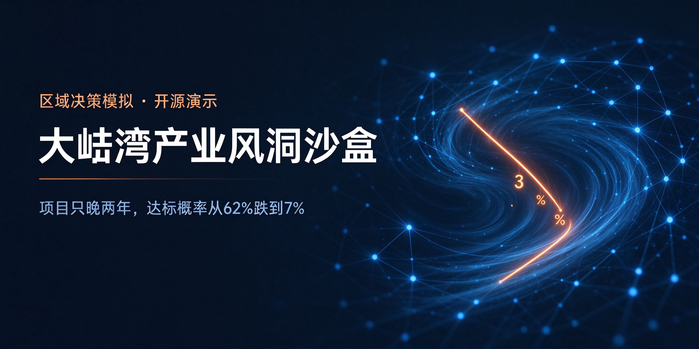

# 你好，我是张凌 👋

**张凌 博士 ｜ 高校副教授 · 南粤优秀教师 · 国际 SCI 期刊审稿人**

**广东省乡村振兴驻镇工作队成员 · 曾任驻村第一书记**

 

我做的事情，可以概括成一句话：

### 把一座城、一个区域的重大决策，先放进“风洞”里跑一遍。

在真正拍板之前，先看清现在正在发生什么，以及“如果这样走，会发生什么”。

 

---

## 🧭 我在做什么

现实中的城市和产业，已经是一张“人—产业—城”互相咬合的网。只凭经验，越来越难算清一句话：**“如果某个变量变了，会怎样？”**

项目晚两年、龙头扩产落空、一条通勤路拥堵、人口没有按预期增长……这些“万一”，都可以在动手之前先跑一遍。

这与国家“加快构建数字技术辅助政府决策机制”“探索建设数字孪生城市”的方向一致；在世界范围内，新加坡、美国、日本、韩国、英国等，也早已把“先算后干”用于区域与城市决策。

---

## 🛠️ 风洞系列 · 开源项目

<table>
<tr>
<td width="50%" valign="top">

 
<b>惠城产业决策风洞</b>
 
26 个主体、三层网络。最该守的可能不是某个龙头，而是<b>一条通勤路</b>。
 
<a href="https://zhanglingshare.github.io/huicheng-simulator/">▶ 在线体验</a> ｜ <a href="https://github.com/zhanglingshare/huicheng-simulator">源码</a>
</td>
<td width="50%" valign="top">

 
<b>大亚湾产业风洞沙盒</b>
 
项目只晚两年，达标概率从 62% 跌到 7%。<b>时间，本身就是变量</b>。
 
<a href="https://zhanglingshare.github.io/dayawan-industrial-sandbox/">▶ 在线体验</a> ｜ <a href="https://github.com/zhanglingshare/dayawan-industrial-sandbox">源码</a>
</td>
</tr>
<tr>
<td width="50%" valign="top">

 
<b>仲恺协同决策模拟器</b>
 
企业之间怎么咬在一起，换成另一个区域也能照样跑。
 
<a href="https://zhanglingshare.github.io/zhongkai-simulator/zhongkai_simulator.html">▶ 在线体验</a> ｜ <a href="https://github.com/zhanglingshare/zhongkai-simulator">源码</a>
</td>
<td width="50%" valign="top">

 
<b>博罗产业决策风洞</b>
 
广东首个千亿县。不靠补短板，靠在大湾区网络里<b>多占几个位置</b>。
 
<b>给普通人做的风洞</b>——12镇吃喝玩乐、按月当季农产品、6 源实时热搜。
 
<a href="https://zhanglingshare.github.io/boluo-simulator/">▶ 在线体验</a> ｜ <a href="https://github.com/zhanglingshare/boluo-simulator">源码</a>
</td>
</tr>
<tr>
<td colspan="2" width="100%" valign="top">

 
<b>区域产业决策风洞（通用模板）</b>
 
不用安装、不用联网，单文件打开，就能给任意一个区域做一次体检。
 
<a href="https://github.com/zhanglingshare/decision-windtunnel">源码</a>
</td>
</tr>
</table>

---

## 💡 这个系列真正想说的

> 你以为的关键——大项目、龙头企业，未必是命门；
> 你以为的背景——投产的时间、一条通勤的路，可能才是。

风洞不替人做决定，它只负责把“没看见的未来”，提前跑给你看。

---

## 📬 联系我

- 邮箱：**68588368@qq.com** ｜ **zhangyu0703@gmail.com**
- 欢迎：数据指正、意见建议、合作与授权

这些项目均由我利用业余时间独立完成，目前未承担、未接受科研项目或基金资助，纯属个人学术兴趣与公益尝试；也正因如此，难免有局限，欢迎一切基于事实的批评与补充。

**让每一个重大决策，先跑一遍。**

